

  <picture>
    <source media="(max-width: 600px)" srcset="./assets/profile/intro-mobile.svg">
    
  </picture>

  <a href="https://t.me/i_sorried"><picture>
    <source media="(max-width: 600px)" srcset="./assets/profile/contact-mobile.svg">
    
  </picture></a>

  <picture>
    <source media="(max-width: 600px)" srcset="./assets/profile/about-mobile.svg">
    
  </picture>

  <picture>
    <source media="(max-width: 600px)" srcset="./assets/profile/stack-mobile.svg">
    
  </picture>

  <a href="https://github.com/sorried?tab=repositories"><picture>
    <source media="(max-width: 600px)" srcset="./assets/profile/languages-mobile.svg">
    
  </picture></a>

  <a href="https://github.com/sorried?tab=overview"><picture>
    <source media="(max-width: 600px)" srcset="./assets/profile/activity-mobile.svg">
    
  </picture></a>

  <a href="https://github.com/sorried?tab=overview" aria-label="Last 30 days: contributions, active days, current streak and longest streak in the past year."><picture>
    <source media="(max-width: 600px)" srcset="./assets/profile/recent-mobile.svg">
    
  </picture></a>

  <picture>
    <source media="(max-width: 600px)" srcset="./assets/profile/projects-mobile.svg">
    
  </picture>

  <a href="https://github.com/sorried/MediaForge"><picture>
    <source media="(max-width: 600px)" srcset="./assets/profile/mediaforge-mobile.svg">
    
  </picture></a>

  <a href="https://github.com/sorried/xyecoc-ipa"><picture>
    <source media="(max-width: 600px)" srcset="./assets/profile/xyecoc-ipa-mobile.svg">
    
  </picture></a>

  <a href="https://github.com/sorried/freshupdate" aria-label="Open freshupdate on GitHub: Telegram release notifications using TypeScript, grammY and SQLite."><picture>
    <source media="(max-width: 600px)" srcset="./assets/profile/freshupdate-mobile.svg">
    
  </picture></a>

  <a href="https://github.com/sorried/modules" aria-label="Open modules on GitHub: Telegram userbot modules using Telethon and TgCrypto."><picture>
    <source media="(max-width: 600px)" srcset="./assets/profile/modules-mobile.svg">
    
  </picture></a>

  <a href="https://github.com/sorried/disable-shorts"><picture>
    <source media="(max-width: 600px)" srcset="./assets/profile/disable-shorts-mobile.svg">
    
  </picture></a>

  <picture>
    <source media="(max-width: 600px)" srcset="./assets/profile/footer-mobile.svg">
    
  </picture>

  <a href="./LICENSE">© 2026 Maya Moon. all rights reserved.</a>

