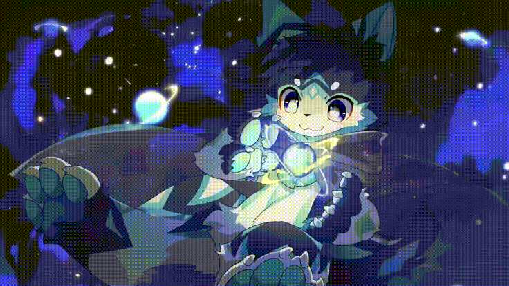
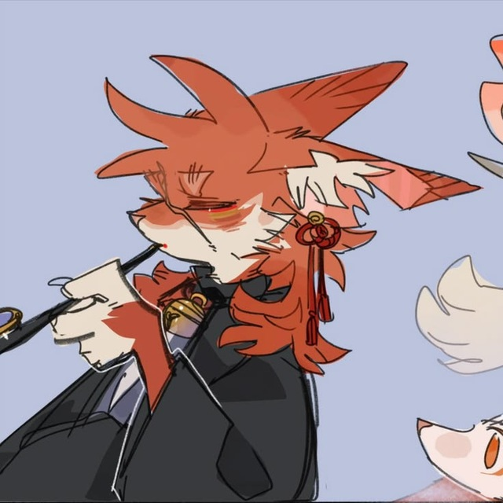

  

<h1>🌙 Maya Moon</h1>

<h4>she/her • 15 y.o. • UTC+5 (MSK+2)</h4>

  <i>crafting bots & swift apps • exploring rust & ui • open-source enthusiast</i>

  🗣️ <b>Speaks:</b> Russian (Native), English &nbsp;•&nbsp; 📍 <b>Location:</b> Chelyabinsk Region, Russia

  
  
  
  

<h3>🛠️ Tech Stack</h3>

  
  
  
  
  
  
  

<h3>⭐ Featured Projects</h3>

  

<h3>🐍 Contribution Activity</h3>

<picture>
  <source media="(prefers-color-scheme: dark)" srcset="https://raw.githubusercontent.com/sorried/sorried/output/github-snake-dark.svg" />
  <source media="(prefers-color-scheme: light)" srcset="https://raw.githubusercontent.com/sorried/sorried/output/github-snake.svg" />
  
</picture>

  

  <i>“Still here, still you.”</i>

